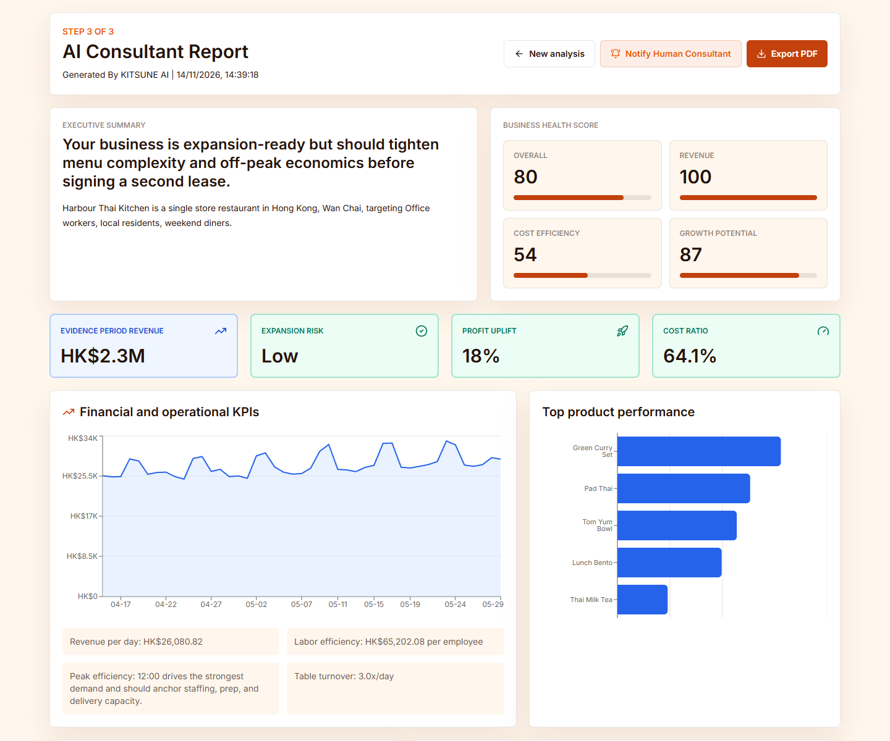
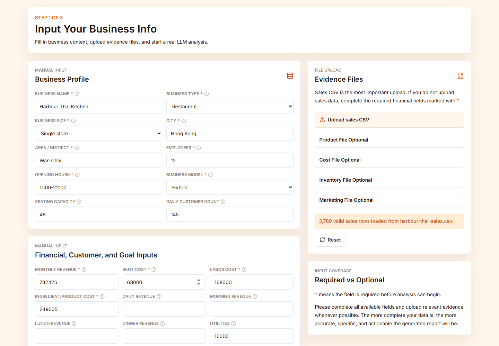
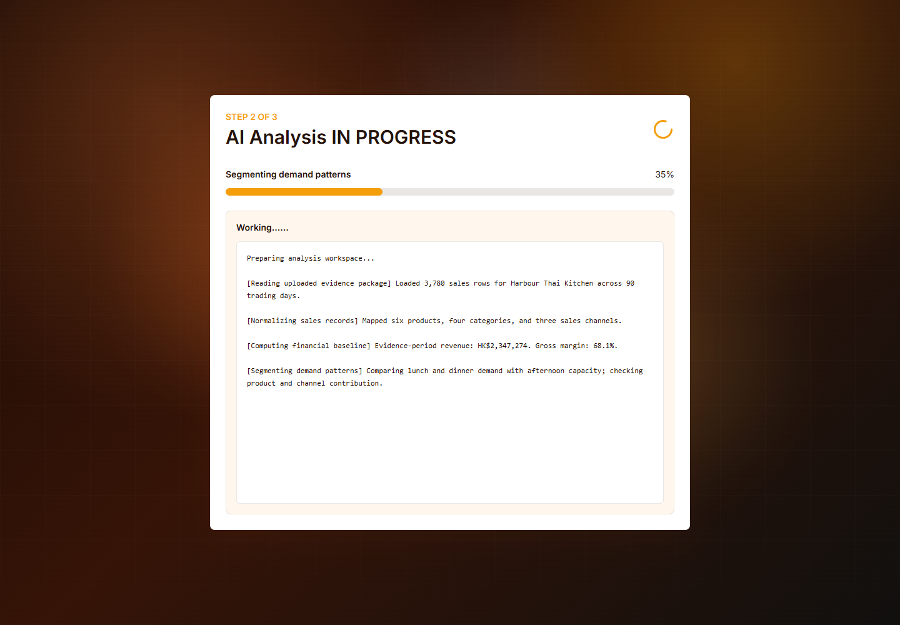
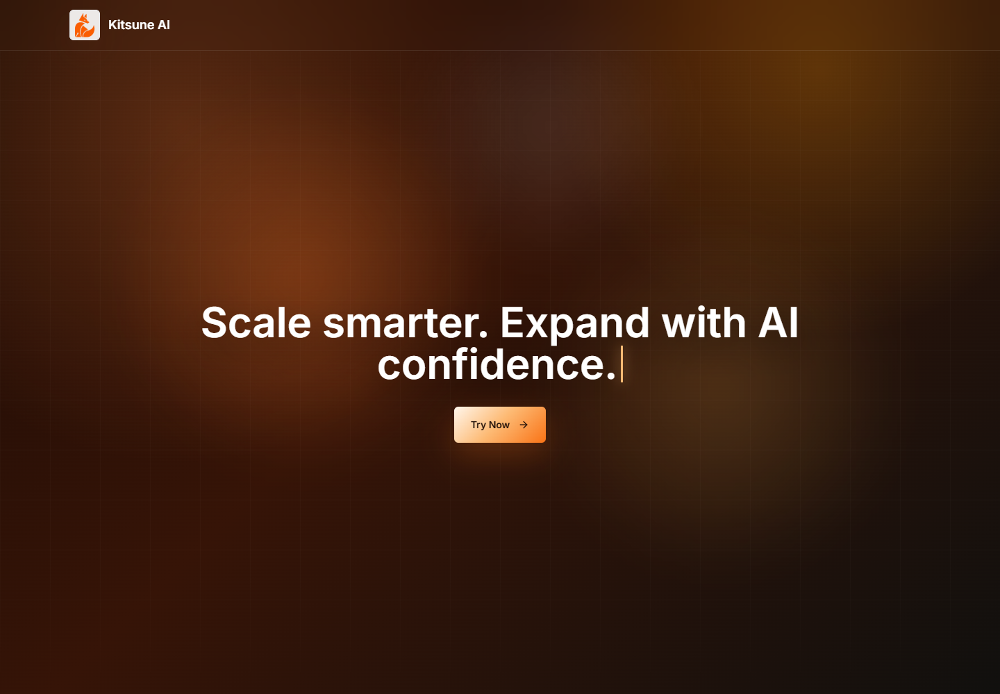
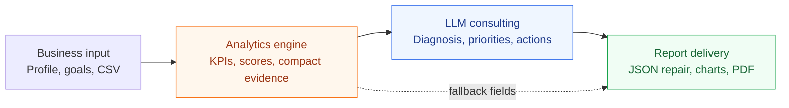

<div align="center">
  
  <h1>Kitsune AI</h1>
  <p><strong>Scale smarter. Expand with AI confidence.</strong></p>
  <p>Business intelligence for the next chapter of your small business.</p>
  <p>
    
    
    
    
  </p>
  <p><strong>English</strong> | <a href="README.zh-CN.md">简体中文</a></p>
  <p><a href="#product-preview">Product preview</a> · <a href="#how-it-works">Architecture</a> · <a href="#quick-start">Run locally</a> · <a href="DEPLOYMENT.md">Deployment</a></p>
</div>

## Why Kitsune

Opening a second location should not require an in-house analytics team. Small restaurant and retail owners often have sales records, but lack the time, expertise, or budget to turn them into expansion decisions.

**Kitsune AI is an AI in Business project developed for the University of Hong Kong (HKU) Summer School.** This repository contains a functional demonstration of the idea: combine business data, transparent calculations, and AI-assisted strategy to make useful business analysis more accessible.

Our vision is to help owners improve margins, understand demand, and grow sustainably, **supporting human judgement rather than replacing it**.

## Product Preview

Actual application screens from a simulated owner journey for **Harbour Thai Kitchen**, a fictional restaurant. Data, progress messages, and report results are illustrative, not a customer case study or evidence of financial returns. No private input templates are included.



<table>
  <tr>
    <td width="50%"></td>
    <td width="50%"></td>
  </tr>
  <tr>
    <td align="center"><strong>01 / Share your business context</strong></td>
    <td align="center"><strong>02 / Follow the analysis</strong></td>
  </tr>
</table>

<details>
<summary>View the product landing page</summary>



</details>

## What You Can Explore

| Owner's question | Demo output |
| :--- | :--- |
| How is my business performing? | Revenue and margin trends, cost ratios, product rankings, customer and channel mix. |
| What should I improve first? | Profit-leakage diagnosis, a top-priority action per section, and impact scenarios. |
| Am I ready for another branch? | Readiness scores, expansion risks, and indicative location comparisons. |
| How do I turn insight into action? | Marketing ideas, a phased roadmap, optional branding/interior briefs, and a print-ready report. |

**Owner journey:** enter business details and sales CSV → start analysis → review charts and recommendations → export through the browser's **Save as PDF** dialog.

## How It Works

**Compute the baseline in code. Use the LLM to interpret it.** This is a hybrid analytics workflow, not a trained proprietary model or an autonomous multi-agent system.



- **Evidence first:** aggregate revenue, costs, trends, and product mix before requesting narrative analysis. The prompt sends summaries and a limited row sample instead of the entire sales CSV.
- **Structured strategy:** the versioned prompt asks for evidence/assumption separation, local-market and currency checks, SWOT/TOWS, Porter analysis, market-sizing assumptions, and one highest-impact priority per section.
- **Resilient output:** the server streams progress events, parses the model's JSON, attempts repair when needed, and fills missing fields from a deterministic fallback. Fallback content is not independently verified analysis.

| Layer | Implementation |
| :--- | :--- |
| Application | Next.js 15 App Router, React 19, TypeScript |
| Interface | Tailwind CSS, Lucide icons, Recharts |
| Data | PapaParse, TypeScript KPI and scoring functions |
| AI | Server-side chat-completions API; configurable endpoint/model; DeepSeek via OpenCode Zen by default |
| Delivery & tests | NDJSON streaming, browser-local report storage, print CSS, Vitest |

**Code map:** [input & storage](src/lib/workflow.ts) · [CSV parser](src/lib/csv.ts) · [KPI engine](src/lib/analysis.ts) · [prompt](src/lib/analysis-prompt.ts) · [LLM orchestration](src/lib/analysis-server.ts) · [stream endpoint](src/app/api/analyze/stream/route.ts) · [report UI](src/app/workspace/report/page.tsx)

## Quick Start

Public production deployments are **landing-page showcases**: the workspace redirects to a maintenance page with a GitHub link, and analysis APIs are disabled. Run locally to explore the functional demo. See [showcase configuration](DEPLOYMENT.md#public-showcase-default).

Use **Node.js 22** and **pnpm**.

```bash
git clone https://github.com/zjmdong/Kitsune_Project.git
cd Kitsune_Project
pnpm install
cp .env.example .env.local
```

Set your own key in `.env.local`. Never commit this file.

```dotenv
KITSUNE_AI_ENDPOINT=https://opencode.ai/zen/go/v1/chat/completions
KITSUNE_AI_MODEL=deepseek-v4-flash
KITSUNE_AI_API_KEY=your_api_key_here
```

```bash
pnpm dev
```

Open [localhost:3000](http://localhost:3000). On Windows, you can also double-click [start-dev.bat](start-dev.bat). A valid API key is required for the normal AI workflow.

To use another provider, set the endpoint and model in **Advanced** on the input page. Compatibility with the request's thinking and JSON options depends on the provider; it is not guaranteed for every chat-completions service.

<details>
<summary>Sales CSV format</summary>

```csv
date,hour,product,category,units,revenue,cost,channel
```

Use `YYYY-MM-DD` dates, hours `0-23`, and numeric revenue/cost totals for each row, not unit prices. Keep one currency per upload and set the business location correctly. Supported channels: `Dine-in`, `Takeaway`, `Delivery`, `Catering`, `Retail`.

Sales CSV is the parsed data source. Optional supporting uploads currently contribute file metadata, not extracted PDF/XLSX document contents.

</details>

**Development:** `pnpm test` runs unit tests; `pnpm build` builds the application; `pnpm start` serves the production build. See [deployment instructions](DEPLOYMENT.md) for Vercel and Cloudflare setup.

## Scope & Data Care

- **Academic prototype:** location metrics, financial scenarios, and fallback recommendations include curated or heuristic assumptions. There is no live market-data retrieval; outputs require independent review. This is not financial or legal advice.
- **Private inputs:** the app has no business-data database. Input and report state use browser local storage; successful completion removes the input payload, while the report remains until replaced or cleared. Real analysis sends business context to the configured provider, whose retention policy also applies.
- **Safe evaluation:** use synthetic or anonymized data. Keep API keys server-side in ignored environment files and keep private templates outside the repository. Local storage is not encrypted storage.
- **Not yet production services:** authentication, tenant isolation, billing, compliance automation, and professional consultant fulfilment are not implemented. The consultant-payment dialog is a UI preview only.

## Looking Ahead

The next steps are source-backed market research, stronger input/output validation, and agent-assisted follow-ups with human consultants. The long-term aim is an accessible decision-support platform that grows with the businesses it serves.
