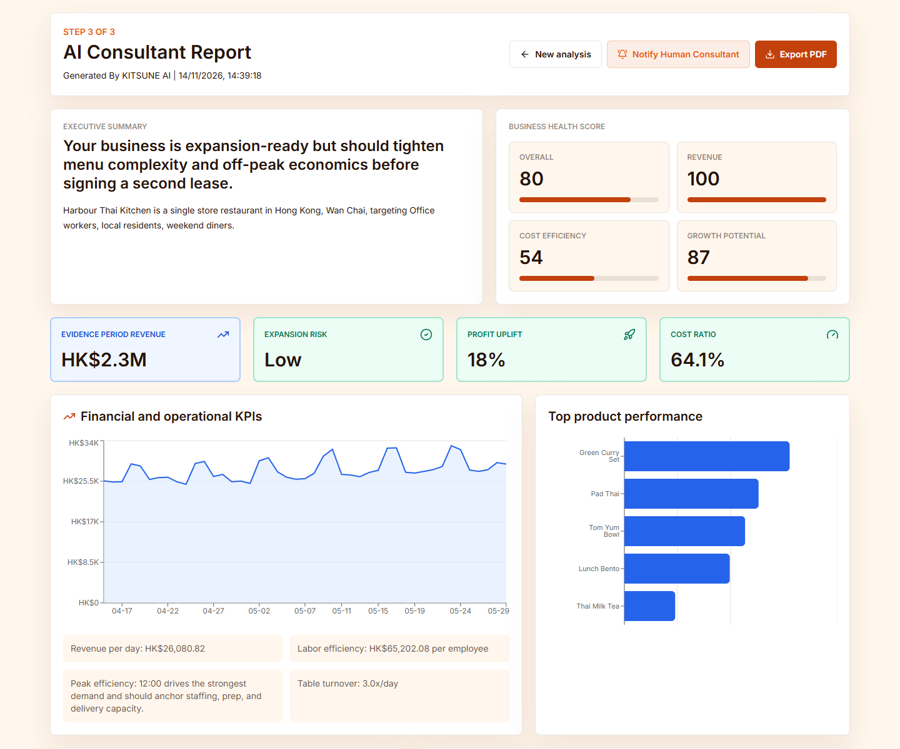
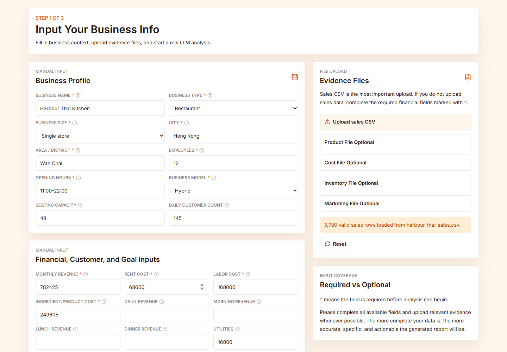
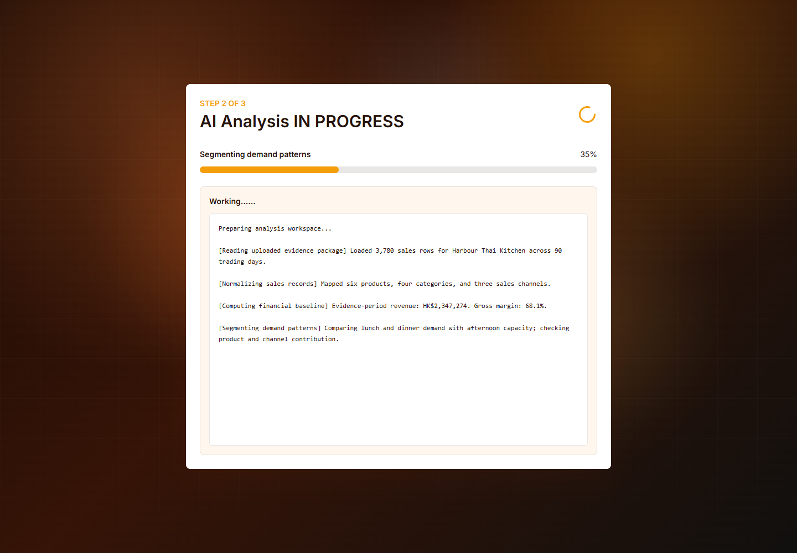
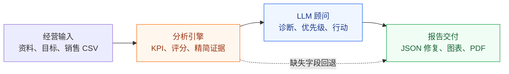

<div align="center">
  
  <h1>Kitsune AI</h1>
  <p><strong>Scale smarter. Expand with AI confidence.</strong></p>
  <p>让中小商家的下一步增长，有据可依。</p>
  <p>
    
    
    
    
  </p>
  <p><a href="README.md">English</a> | <strong>简体中文</strong></p>
  <p><a href="#产品预览">产品预览</a> · <a href="#技术实现">技术架构</a> · <a href="#本地运行">本地运行</a> · <a href="DEPLOYMENT.md">部署指南</a></p>
</div>

## 为什么做 Kitsune

从一家店走向第二家店，不应该以拥有专业分析团队为前提。中小餐饮与零售商家并不缺经营数据，却往往缺少解读数据的时间、经验，以及聘请咨询师的预算。

**Kitsune AI 是香港大学（HKU）夏校的 AI in Business 项目。** 本仓库包含一个可运行的功能展示 Demo：将经营数据、可复现的指标计算与 AI 策略分析结合，降低商家获得商业洞察的门槛。

我们的愿景是帮助商家改善利润、理解需求、稳健扩张，**辅助人的判断，而非取代人的经验**。

## 产品预览

以下为实际应用界面，以虚构餐厅 **Harbour Thai Kitchen** 模拟正常使用流程。数据、进度信息及报告结果仅用于功能展示，不是真实客户案例或收益证明；不包含私人输入模板。



<table>
  <tr>
    <td width="50%"></td>
    <td width="50%"></td>
  </tr>
  <tr>
    <td align="center"><strong>01 / 提供经营背景</strong></td>
    <td align="center"><strong>02 / 查看分析进展</strong></td>
  </tr>
</table>

<details>
<summary>查看产品落地页</summary>


</details>

## 可以体验什么

| 商家的问题 | Demo 提供的结果 |
| :--- | :--- |
| 生意目前表现如何？ | 收入与毛利趋势、成本占比、产品排名、客群与渠道结构。 |
| 应该先改善哪里？ | 利润流失诊断、各部分的最高优先事项，以及影响情景模拟。 |
| 现在适合开分店吗？ | 扩张准备度、风险提示与参考性选址比较。 |
| 如何把分析变成行动？ | 营销建议、分阶段路线图、可选品牌/室内风格 brief，以及可打印报告。 |

**使用流程：** 填写经营资料并上传销售 CSV → 开始分析 → 查看图表与建议 → 通过浏览器的 **另存为 PDF** 导出报告。

## 技术实现

**代码负责计算基线，LLM 负责解读与建议。** 项目采用混合分析流程，并非自行训练的专有模型，也不是自主运行的多智能体系统。



- **先计算，再解释：** 先聚合收入、成本、趋势和产品结构；提示词传入统计摘要与少量记录样本，而不是整份销售 CSV。
- **结构化策略分析：** 版本化提示词要求区分证据与假设、检查市场与币种，结合 SWOT/TOWS、波特五力和市场规模假设，为每个部分选择一项最高优先行动。
- **更稳健的输出：** 服务端推送进度事件，解析模型 JSON，必要时尝试修复，并用确定性回退逻辑补全缺失字段。回退内容不等于已经独立验证的分析。

| 层级 | 实现 |
| :--- | :--- |
| 应用框架 | Next.js 15 App Router、React 19、TypeScript |
| 界面与图表 | Tailwind CSS、Lucide、Recharts |
| 数据处理 | PapaParse、TypeScript KPI 与评分函数 |
| AI 接入 | 服务端 chat-completions API；端点与模型可配置，默认通过 OpenCode Zen 调用 DeepSeek |
| 交付与测试 | NDJSON 流式响应、浏览器本地报告存储、打印样式、Vitest |

**代码导航：** [输入与存储](src/lib/workflow.ts) · [CSV 解析](src/lib/csv.ts) · [KPI 引擎](src/lib/analysis.ts) · [提示词](src/lib/analysis-prompt.ts) · [LLM 编排](src/lib/analysis-server.ts) · [流式接口](src/app/api/analyze/stream/route.ts) · [报告界面](src/app/workspace/report/page.tsx)

## 本地运行

公开的生产部署默认**仅展示落地页**：工作台跳转至带有 GitHub 链接的维护提示页，分析接口关闭。完整功能 Demo 可在本地运行，配置见[公开展示模式](DEPLOYMENT.md#public-showcase-default)。

准备 **Node.js 22** 和 **pnpm**。

```bash
git clone https://github.com/zjmdong/Kitsune_Project.git
cd Kitsune_Project
pnpm install
cp .env.example .env.local
```

在 `.env.local` 中填写自己的 API key。不要提交此文件。

```dotenv
KITSUNE_AI_ENDPOINT=https://opencode.ai/zen/go/v1/chat/completions
KITSUNE_AI_MODEL=deepseek-v4-flash
KITSUNE_AI_API_KEY=your_api_key_here
```

```bash
pnpm dev
```

打开 [localhost:3000](http://localhost:3000)。Windows 用户也可双击 [start-dev.bat](start-dev.bat)。正常 AI 分析流程需要有效的 API key。

使用其他服务商时，可在输入页的 **Advanced** 中修改端点与模型。服务商需要支持请求中的 thinking 和 JSON 参数，不能保证所有 chat-completions 服务均兼容。

<details>
<summary>销售 CSV 格式</summary>

```csv
date,hour,product,category,units,revenue,cost,channel
```

日期使用 `YYYY-MM-DD`，小时使用 `0-23`，收入与成本填写每行记录的合计金额，而非单价。一份文件应使用同一币种，并正确填写商家所在地。渠道支持 `Dine-in`、`Takeaway`、`Delivery`、`Catering`、`Retail`。

销售 CSV 会被实际解析。当前可选辅助文件仅提供文件元信息，尚不提取 PDF/XLSX 正文。

</details>

**开发命令：** `pnpm test` 运行单元测试；`pnpm build` 构建应用；`pnpm start` 启动生产构建。Vercel 和 Cloudflare 的配置见[部署指南](DEPLOYMENT.md)。

## 边界与数据

- **教学原型：** 选址指标、财务情景与回退建议包含整理数据或启发式假设，尚未接入实时市场检索。结果需要独立核实，不构成财务或法律建议。
- **数据流向：** 应用没有经营数据数据库；输入与报告通过浏览器 localStorage 保存。成功生成报告后删除输入载荷，报告保留至被替换或清除。真实分析会将经营上下文发送给配置的服务商，也受其数据保留政策约束。
- **安全体验：** 建议使用虚构或脱敏数据。API key 放在服务端且被 Git 忽略的环境文件中，私人模板保留在仓库外。localStorage 并非加密存储。
- **尚未上线的服务：** 登录、租户隔离、计费、合规自动化与专业咨询履约均未实现；人工顾问付款弹窗仅为界面展示。

## 下一步

后续方向是接入有来源的市场证据、加强输入输出校验，并探索智能体跟进与人工顾问协作。长期目标是让商家在不同成长阶段，都能获得易用、可理解的决策支持。
